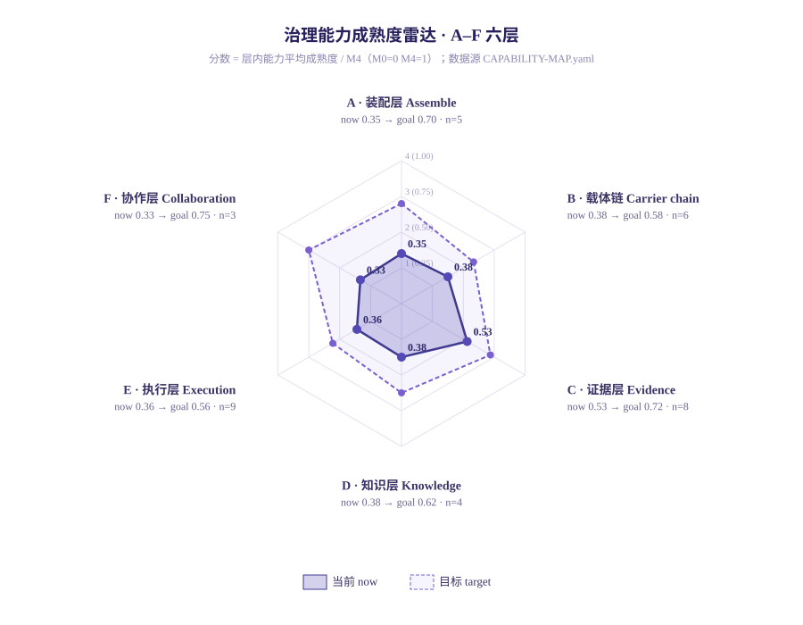
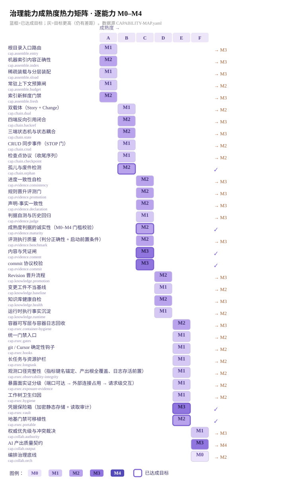

# AI Governance Closed-Loop Framework

 

> Document-level loop engineering for AI-assisted development — deterministic gates,
> full traceability, and fact persistence for Cursor / Claude Code / Codex / Copilot.

**[中文版 README](README.zh-CN.md)**（治理正文为简体中文；this English README is an overview）

For cross-machine Git access and the shared `main` branch, see [GIT-ACCESS.md](GIT-ACCESS.md).

## The problem

AI coding agents drift. In long sessions they fall back to "do first, account later":
PRDs lag behind implementation, changes get archived without verification, credentials
get re-asked every session, and always-loaded context files silently bloat until they
eat your context window. Prompt-level discipline ("please follow the workflow") does
not survive session boundaries.

This framework makes the discipline **enforceable** instead of aspirational:

- **Deterministic gates** — zero-dependency Python checks wired into pre-commit hooks
  and CI. If traceability is broken, the commit is rejected. No LLM goodwill required.
- **Three-way binding** — every commit must reference a Story (PRD), an OpenSpec
  change, and/or a Revision. Cross-references are validated bidirectionally, with
  content hashes linking acceptance criteria to spec deltas.
- **Fact persistence** — credentials (by reference, never plaintext), addresses,
  ports, and project conventions are written back the same turn the user provides
  them, and consulted before the agent asks again.
- **Token budget engineering** — always-loaded entry files have a hard token budget
  gate; everything else loads on demand via a trigger-scored context loader.

## Architecture

```
Governance   (Authority)  — what must / must not be done
  foundations/ · domains/ (L1/L2/L3 tree) · profiles/
Agents       (Capability) — who does it, with governance bindings
  agents/core · specialists · design · meta   (20 curated agents)
Workflow     (Process)    — how changes flow
  OpenSpec (spec-driven changes) + BMAD (PRD/story lifecycle), bound bidirectionally
Skills       (Behavior)   — how to do it well
  .claude/skills/ (localized zh-CN), mirrored to .agents/skills/
──────────────────────────────────────────────────────────
Self-governance — token-budgeted sparse loading, health checks, revision promotion
Binding layer   — Story ↔ Change ↔ Revision ↔ Rule ↔ Commit, machine-validated
```

## Governance maturity (current state)

The framework dogfoods itself. Its own capabilities are scored M0–M4 in
[`docs/governance-roadmap/CAPABILITY-MAP.yaml`](docs/governance-roadmap/CAPABILITY-MAP.yaml)
(35 capabilities across 6 layers) and **the score is never self-promoted** —
M2 needs a destructive test that actually caught a defect, M3 needs a paired
experiment with a reported effect size or ≥8 rejected bypass attempts, M4 needs
cross-task replication. Missing evidence drops a capability back down.


| Layer | Now → Goal | Distribution |
|---|---|---|
| A Assemble (entry & context loading) | 0.35 → 0.70 | M1×3 M2×2 |
| B Carrier chain (Story/Change/Revision binding) | 0.38 → 0.58 | M1×3 M2×3 |
| C Evidence (gates, content/commit/consistency checks) | 0.53 → 0.72 | M1×1 M2×5 M3×2 |
| D Knowledge (persistence & promotion) | 0.38 → 0.62 | M1×2 M2×2 |
| E Execution (hooks, vault, portability) | 0.36 → 0.56 | M1×6 M2×2 M3×1 |
| F Collaboration (authority, AI output quality) | 0.33 → 0.75 | M0×1 M1×1 M3×1 |

Regenerate after editing the capability map:

```bash
python scripts/gen_capability_viz.py
```

**Radar — current vs target per layer** (score = mean maturity across a layer's
capabilities, normalized M0=0 → M4=1):



**Heatmap — every capability, M0–M4** (blue border = reached its target):



The weakest area is **F Collaboration** (orchestration governance is still M0)
and the broad **E Execution** layer, which is mostly M1 (executable but not yet
proven to catch defects). The strongest is **C Evidence**, which carries two M3
capabilities backed by the adversarial bypass suites under `benchmark/` and
`scripts/check_*_bypass.py`.

## Deterministic gates (the hard part)

| Gate | What it blocks |
|------|----------------|
| `check_progress_consistency.py --strict` | Story/Change/Revision state drift, broken back-references, hash mismatches |
| `check_commit_message.py` | commits without Story/Change/Revision trailers; code changes without an OpenSpec change |
| `check_staged_content.py` | plaintext secrets in staged lines; non-UTF-8 text files |
| `check_context_budget.py` | always-loaded context exceeding the per-tool token budget |
| `check_worktree_hygiene.py` | generated-artifact churn masquerading as real changes |
| `check_knowledge_health.py` | placeholder rot, orphan rules, stale revisions, oversized fact manifests |

All gates are zero-dependency (stdlib only), git-optional, and mirrored to CI via
bundled GitHub Actions / GitLab CI templates. Local hooks can be bypassed with
`--no-verify`; CI cannot.

## Quickstart

Adopt the framework into a project (creates `docs/governance/`, manifest, hooks):

```bash
# Linux / macOS
./scripts/bootstrap.sh --project-root /path/to/your-project --profile backend-service

# Windows
powershell -File scripts/bootstrap-windows.ps1 -ProjectRoot C:\path\to\your-project
```

Then, inside the project, the daily loop is:

```
/opsx:propose  →  implement (/opsx:apply)  →  /opsx:verify  →  "继续" checkpoint
                  → human-verification prompt → archive + code in ONE commit → push
```

Agent entry points are auto-generated: `AGENTS.md` (Codex/Cursor), `CLAUDE.md`
(Claude Code), `.github/copilot-instructions.md` (Copilot) — all kept under the
token budget gate.

## What this is good for — and not

Designed for **long-lived projects** where PRD/spec/implementation drift compounds:
multi-week solo or small-team work driven through AI CLIs. It is deliberately heavy
for one-off scripts — the ceremony (story + change + trailers) costs more than it
returns on a 20-line fix. Known trade-offs are documented honestly:
resident-context token overhead (budgeted ≤ 6k/tool), per-change ceremony,
and local hooks being bypassable (mitigated by CI mirroring).

## Repository layout

```
00-08 *.md            governance core docs (charter, principles, verification policy)
00-index.yaml         machine index (schema v2, trigger-scored)
foundations/          methodology constraints        profiles/   project-type bundles
domains/              L1/L2/L3 domain tree           agents/     20 curated agents
openspec/             OpenSpec change management     _bmad/      BMAD config + bridge
.claude/skills/       localized skills (zh-CN)       scripts/    20 zero-dep gate/tool scripts
templates/            bootstrap + CI + manifest templates
revisions/            revision workflow (candidate → merged → promoted)
```

## Upstream components

Built on top of (all MIT, see [THIRD-PARTY-NOTICES.md](THIRD-PARTY-NOTICES.md)):
[OpenSpec](https://www.npmjs.com/package/@fission-ai/openspec) 1.5.0 ·
[BMAD-METHOD](https://github.com/bmad-code-org/BMAD-METHOD) 6.10.0 ·
[agency-agents](https://github.com/msitarzewski/agency-agents) (reference only, not vendored).
Version pins: `UPSTREAM-VERSIONS.yaml`.

## License

[MIT](LICENSE) © 2026 RiTian1
