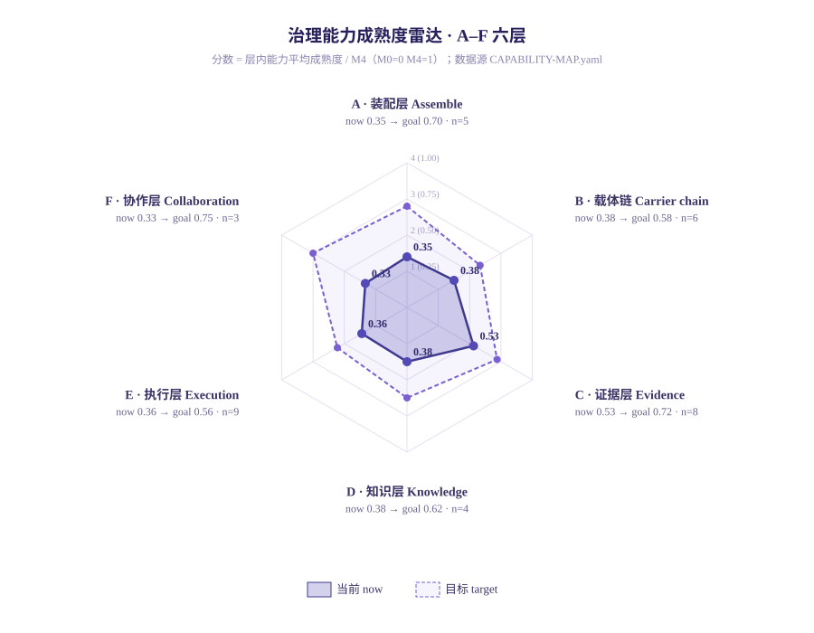
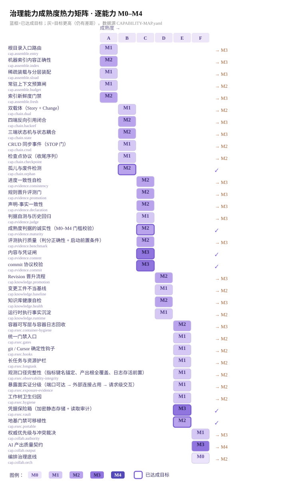

# AI 治理闭环框架

 

> 面向 AI 辅助开发的文档级 loop engineering——确定性门禁、全链路可追溯、事实自动沉淀，
> 适配 Cursor / Claude Code / Codex / Copilot。

**[English README](README.md)**

跨机器、跨 agent 维护本仓时，先看 [Governance Git 跨机器维护入口](GIT-ACCESS.md)。NAS GitLab 的 `root/governance` 项目以 `main` 为共享权威分支。

## 要解决的问题

AI 编码代理在长会话里必然跑偏：先做事后补账、PRD 进度落后实现、变更未验证就归档、
凭证每个会话重复询问、常驻上下文文件被一轮轮"加几行"撑爆窗口。靠提示词层面的纪律
（"请遵守工作流"）撑不过会话边界。

本框架把纪律从"期望"变成"可强制执行"：

- **确定性门禁**——零依赖 Python 自检接入 pre-commit 与 CI；追溯链断裂即拒绝提交，
  不依赖 LLM 的自觉。
- **三向绑定**——每次 commit 必须携带 Story（PRD）/ OpenSpec change / Revision
  trailer；三端反向引用双向校验，验收标准与 spec delta 以内容哈希联动。
- **事实沉淀**——凭证（只存引用、禁明文）、地址、端口、项目约定在使用者提供的
  **当轮**写回清单，agent 问前必查，杜绝重复询问。
- **Token 预算工程**——常驻入口文件有硬预算闸（默认 6k/工具）；其余内容经
  trigger 评分的 context loader 按需装载，禁止全量加载。

## 四层架构 + 两个横切层

```
治理层（Authority）  —— 什么不能做、什么必须做
  foundations/ · domains/（L1/L2/L3 树）· profiles/
代理层（Capability）—— 谁来做（20 个带 governance 绑定的策展代理）
  agents/core · specialists · design · meta
工作流层（Process） —— 变更如何流转
  OpenSpec（规范驱动变更）+ BMAD（PRD/Story 生命周期），双向绑定
技能层（Behavior）  —— 如何做得更好
  .claude/skills/（中文化）镜像到 .agents/skills/
──────────────────────────────────────────────
自治理层 —— token 预算稀疏装载、健康自检、revision 晋升循环
绑定层   —— Story ↔ Change ↔ Revision ↔ Rule ↔ Commit 机器校验
```

## 治理成熟度（当前状态）

本框架吃自己的狗粮：35 个治理能力按 6 层评分（M0–M4）记在
[`docs/governance-roadmap/CAPABILITY-MAP.yaml`](docs/governance-roadmap/CAPABILITY-MAP.yaml)，
**等级不可自评晋升**——M2 需破坏性测试真抓到缺陷，M3 需配对实验报出效应量或 ≥8 次绕过
尝试全被拒，M4 需跨任务复现。缺证据自动降级。

| 层 | 当前 → 目标 | 分布 |
|---|---|---|
| A 装配层（入口与上下文装载） | 0.35 → 0.70 | M1×3 M2×2 |
| B 载体链（Story/Change/Revision 绑定） | 0.38 → 0.58 | M1×3 M2×3 |
| C 证据层（内容/commit/一致性门禁） | 0.53 → 0.72 | M1×1 M2×5 M3×2 |
| D 知识层（持久化与晋升） | 0.38 → 0.62 | M1×2 M2×2 |
| E 执行层（钩子、保险箱、可移植性） | 0.36 → 0.56 | M1×6 M2×2 M3×1 |
| F 协作层（权威裁决、AI 产出质量） | 0.33 → 0.75 | M0×1 M1×1 M3×1 |

改完能力地图后重新生成（雷达 + 热力矩阵 + 徽章）：

```bash
python scripts/gen_capability_viz.py
```

**雷达图**——六层当前 vs 目标（分数 = 层内能力平均成熟度，归一化 M0=0 → M4=1）：



**热力矩阵**——逐能力 M0–M4（蓝框 = 已达成目标）：



最弱的是 **F 协作层**（编排治理仍 M0）和体量最大的 **E 执行层**（多为 M1，能跑但还没证明
能抓错）；最强是 **C 证据层**，两个 M3 能力由 `benchmark/` 与 `scripts/check_*_bypass.py`
下的对抗测试集支撑。

## 确定性门禁（硬核部分）

| 门禁 | 拦截什么 |
|------|---------|
| `check_progress_consistency.py --strict` | Story/Change/Revision 状态漂移、反向引用断裂、哈希不一致 |
| `check_commit_message.py` | 无 trailer 的提交；命中 `code_paths` 却不挂 OpenSpec change |
| `check_staged_content.py` | staged 新增行中的明文凭证；非 UTF-8 文本 |
| `check_context_budget.py` | 常驻上下文超各工具 token 预算 |
| `check_worktree_hygiene.py` | 生成产物 churn 冒充真实变更 |
| `check_knowledge_health.py` | 占位符腐化、orphan 规则、stale revision、事实清单超体量 |

全部零依赖（仅标准库）、git-optional，并附 GitHub Actions / GitLab CI 模板做远端
镜像——本地 hook 可被 `--no-verify` 绕过，CI 不能。

## 快速开始

把框架接入一个项目（生成 `docs/governance/`、manifest、git hooks）：

```bash
# Linux / macOS
./scripts/bootstrap.sh --project-root /path/to/your-project --profile backend-service

# Windows
powershell -File scripts/bootstrap-windows.ps1 -ProjectRoot C:\path\to\your-project
```

日常循环：

```
/opsx:propose → 实施（/opsx:apply）→ /opsx:verify → 达到收尾条件时执行治理检查点
              → 询问人工验证 → 归档与代码同一次提交 → push
```

Agent 入口自动生成：`AGENTS.md`（Codex/Cursor）、`CLAUDE.md`（Claude Code）、
`.github/copilot-instructions.md`（Copilot），全部受 token 预算闸约束。

## 治理工具链速查

```bash
python scripts/context_loader.py --phase apply --keywords "ui,api" --budget 8000  # 按预算装配上下文
python scripts/check_progress_consistency.py --strict    # 三向一致性
python scripts/check_knowledge_health.py --all           # 知识库健康
python scripts/gen_progress_matrix.py --report _logs/progress-matrix.md  # 追溯矩阵
python scripts/install_governance_gates.py               # 一键装 hooks + 自检
python scripts/preflight_check.py --loop <id>            # 重型任务执行前资源预检
```

## 适用与不适用

为**长周期项目**设计：跨多周的个人/小团队开发、经 AI CLI 驱动、PRD 与实现漂移会
复利放大的场景。对一次性脚本刻意偏重——20 行的小修补走 story + change + trailer
的仪式成本大于收益。已知代价如实声明：常驻 token 开销（预算 ≤ 6k/工具）、
单变更仪式成本、本地 hook 可绕过（以 CI 镜像缓解）。

## 目录结构

```
00-08 *.md            治理主文档（宪章 / 工程原则 / 验证政策等）
00-index.yaml         机器索引（schema v2，trigger 评分）
foundations/          方法论约束（11 个）        profiles/   项目类型组合（8 个）
domains/              L1/L2/L3 领域树（10 个 L1） agents/     策展代理（20 个）
openspec/             OpenSpec 变更管理          _bmad/      BMAD 配置与治理桥
.claude/skills/       中文化技能                 scripts/    零依赖门禁/工具脚本（20 个）
templates/            bootstrap / CI / manifest 模板
revisions/            修订流程（candidate → merged → 晋升）
```

## 上游组件

基于以下 MIT 组件构建（声明见 [THIRD-PARTY-NOTICES.md](THIRD-PARTY-NOTICES.md)）：
[OpenSpec](https://www.npmjs.com/package/@fission-ai/openspec) 1.5.0 ·
[BMAD-METHOD](https://github.com/bmad-code-org/BMAD-METHOD) 6.10.0 ·
[agency-agents](https://github.com/msitarzewski/agency-agents)（仅参考、不 vendored）。
版本锁定见 `UPSTREAM-VERSIONS.yaml`。

## 许可

[MIT](LICENSE) © 2026 RiTian1
